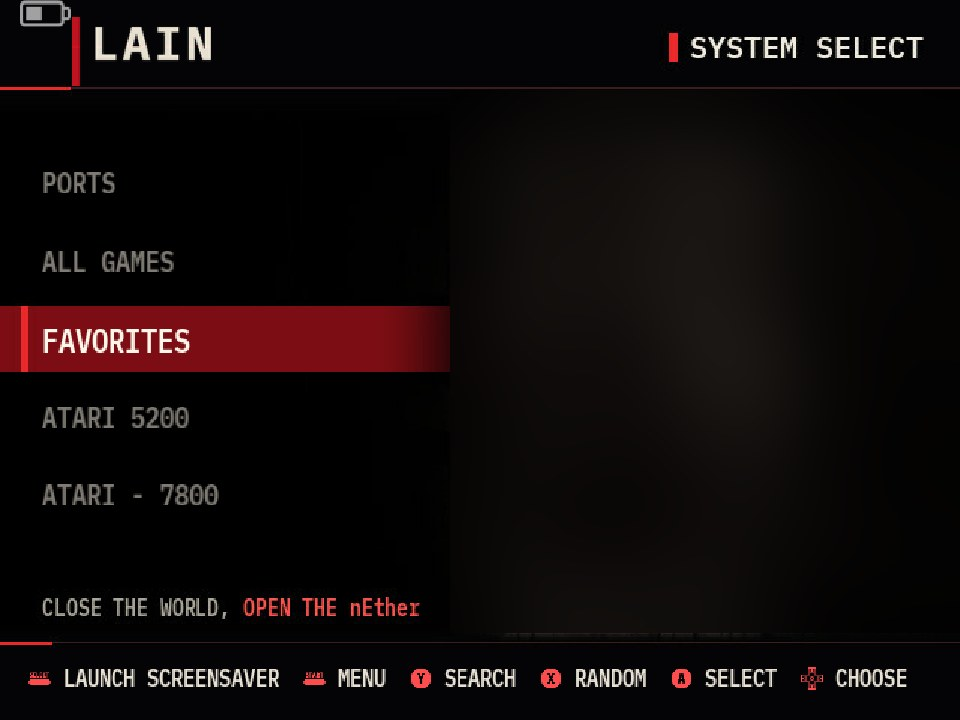
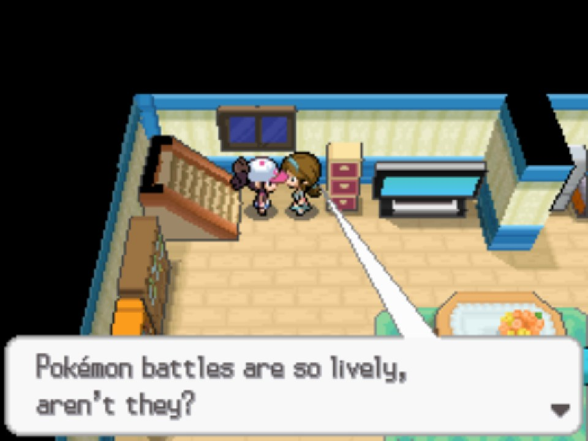

You can find the code at: [github.com/luis-ota/r36s-restauracao](https://github.com/luis-ota/r36s-restauracao).

Listen to `Aphex Twin - Xtal` while reading!

<iframe style="border-radius:12px" src="https://open.spotify.com/embed/track/2gXwXyWOrZrk8OpfRFgi8k?utm_source=generator" width="100%" height="152" frameBorder="0" allowfullscreen="" allow="autoplay; clipboard-write; encrypted-media; fullscreen; picture-in-picture" loading="lazy"></iframe>

## the setup

i've been restoring an r36s, one of those cheap linux handhelds. arkos 2.0 on top of ubuntu 19.10, kernel 4.4, an rk3326 with a mali-g31, and a 640x480 screen. it got a custom theme and a pile of games.



the main game is a ds game, running on drastic. and drastic has one problem for someone who forgets to save: there is no autosave.

not hidden, not under a flag. i searched the binary and `drastic.cfg`. it does not exist.

## the obvious idea that failed

drastic has save state and load state on hotkeys. so the plan was simple: a small service that presses "save state" every few minutes.

first try: create a virtual joystick with `uinput` and press the mapped button. the kernel happily created the device. my log said the button was pressed. the savestate file never changed. drastic just ignored it.

i don't know exactly why. i only know it didn't work, every time.

## the turn: be a keyboard

drastic also listens to keyboard shortcuts. in this build, `F5` saves the state and `F7` loads it. so instead of pretending to be a gamepad, the service pretends to be a usb keyboard for a few seconds:

```python
def apertar(tecla_alvo):
    fd = os.open("/dev/uinput", os.O_WRONLY | os.O_NONBLOCK)
    try:
        fcntl.ioctl(fd, UI_SET_EVBIT, EV_KEY)
        for tecla in range(1, 249):
            fcntl.ioctl(fd, UI_SET_KEYBIT, tecla)
        dev = struct.pack("80sHHHHI", b"r36s-kbd\0", 3, 0x1, 0x1, 0x1, 0)
        os.write(fd, dev.ljust(1116, b"\0"))
        fcntl.ioctl(fd, UI_DEV_CREATE)
        time.sleep(2.5)  # give sdl time to see the new keyboard
        os.write(fd, EVENTO.pack(0, 0, EV_KEY, tecla_alvo, 1) + EVENTO.pack(0, 0, 0, 0, 0))
        time.sleep(0.25)
        os.write(fd, EVENTO.pack(0, 0, EV_KEY, tecla_alvo, 0) + EVENTO.pack(0, 0, 0, 0, 0))
        time.sleep(0.5)
        fcntl.ioctl(fd, UI_DEV_DESTROY)
    finally:
        os.close(fd)
```

create the keyboard, wait for sdl to notice it, press, release, destroy. nothing stays plugged in between saves. first injected `F5` with the game running: the savestate file got a new timestamp and the game kept going. that was the moment.



## the dangerous part

pressing save is easy. pressing save at the wrong time is how you lose a whole run.

the game always boots from zero. drastic doesn't load your last state on its own. so if the service saves in the first minutes, it writes an empty game on top of your real progress. a naive autosave is a progress eraser with a timer.

so the rule became: **don't arm until a load actually happened.**

"actually" matters. seeing someone press `L1`, the load button, is not proof. the service watches the savestates folder with `inotify`, and only arms when drastic *reads* a `.dss` file within 3 seconds of an `F7` or an `L1`. no read, no autosave. when the game closes, it disarms.

```
game opens      -> try F7, wait
.dss read <=3s  -> ARMED
every 3 min     -> any button pressed since last save? -> F5
game closes     -> disarmed
```

## the small rules

- it saves every 3 minutes, but only if a button was pressed since the last save. if i put the console down, it stops writing to the sd card.
- drastic had no exit shortcut either, so the service owns one: hold **SELECT + START** to quit.
- if it's not armed, quitting doesn't save. losing a few minutes is better than overwriting the save with a blank game.

## what i'd tell past me

the bug i was afraid of was never "the save didn't happen". it was "the save happened on top of the wrong thing". making the keypress work was the fun part. the guard was the actual work.

an autosave is not a timer. it's a timer plus proof that there is something worth saving.

## image credits

- all images are my own photos and screenshots of the device. the theme background was blurred out because the original art is not mine.
