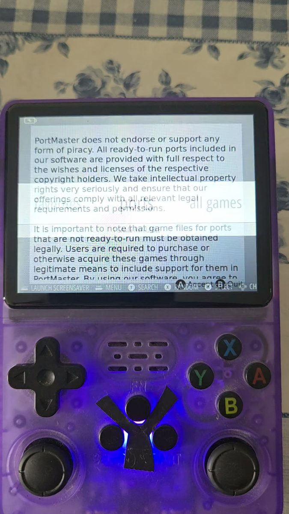
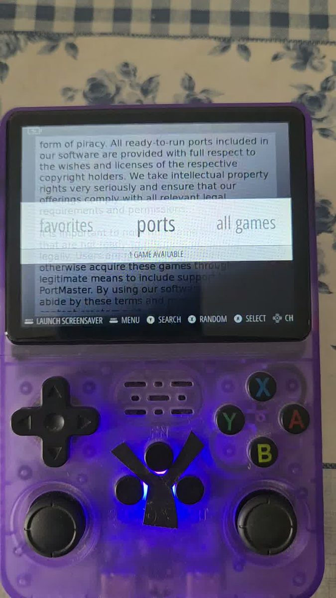
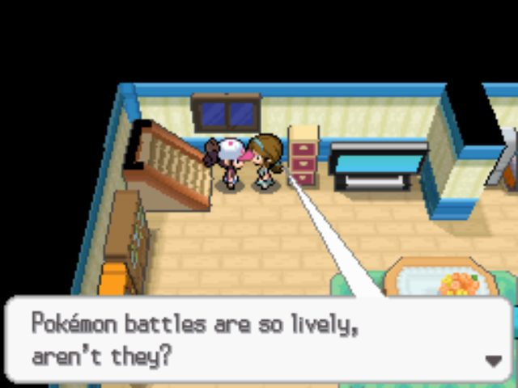
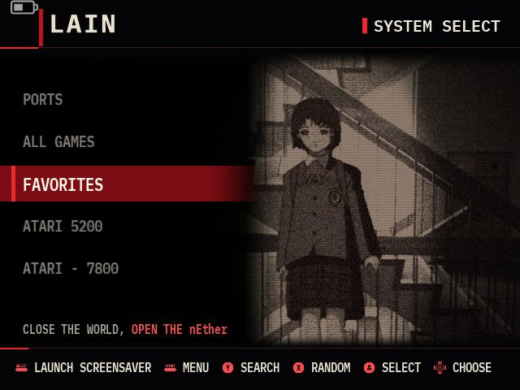
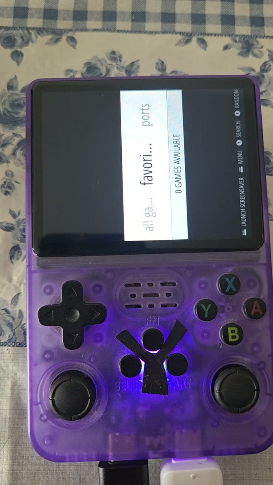

You can find the code, the scripts and the notes at: [github.com/luis-ota/r36s-restauracao](https://github.com/luis-ota/r36s-restauracao).

Listen to `bôa - Duvet` while reading!

<iframe style="border-radius:12px" width="100%" height="166" scrolling="no" frameborder="no" allow="autoplay; encrypted-media" src="https://w.soundcloud.com/player/?url=https%3A//soundcloud.com/boa76436/duvet&color=%23a3242c&auto_play=false&hide_related=true&show_comments=false&show_user=true&show_reposts=false&visual=false"></iframe>

this is the story of a handheld that spent years as a test bench, stopped at the logo one day, and came back through a notebook, a pile of cards and a lot of patience.



no factory image was flashed. everything here was rebuilt from what the original card still had.

---

## the day it stopped

the first symptom looked like software. the console booted, showed the arkos splash, started the loading animation and stayed there. no error, no shell, no menu. the animation kept going while nothing else happened.

this device had a history. i had upgraded packages on it, added a swap file, changed services, installed things that were never meant to live on a handheld with one gigabyte of ram. the kind of maintenance that works until the day it does not.

i spent sunday night on it. restart, wait, restart, wait. then i gave up and went to sleep.

monday morning i changed the plan: stop trying to boot the console, start reading the card.

## the card had more than one problem

the original card was 58.2 gb, with the layout arkos uses: a boot partition, a 6.5 gb ext4 root, and an exfat partition holding the games.

checking each filesystem separately is the moment the mystery fell apart:

```bash
e2fsck -fn /dev/sdb2     # root
fsck.exfat -n /dev/sdb3  # games
fsck.fat -n /dev/sdb1    # boot
```

| partition | what the check said |
|---|---|
| root (ext4) | clean, 148,564 files, zero errors |
| games (exfat) | 877 errors, 524 directory entries with an invalid type, 353 files with clusters marked free |
| boot (fat) | dirty bit set, boot sector different from its backup |

the root being clean is the important line. the system had not died inside. the files were there.

the games partition was the broken one, and the boot partition carried the fingerprint of what caused it: a dirty bit means the card was powered off or pulled without being unmounted. that is how it got corrupted the first time, and it is why the same damage came back after every repair.

## why a broken games partition stops the boot

this is the part nobody tells you. on this system `/roms` is part of `local-fs.target`, so the games partition is mounted **during the boot**, before the menu exists. when the mount fails, the boot stops there and the screen keeps the last frame it drew: the splash animation.

the console was not slow. it was stopped in the middle of the boot, waiting for a filesystem that could never answer.

that single line explains weeks of "it freezes on the logo" reports for this device family. it is almost never the system that died. it is a mount timeout nobody is watching.

## four cards, three lies

with the diagnosis in hand, the next question was where to rebuild. i tested every card i had, and that was its own adventure.

**the 128 gb that was not.** it formatted, it mounted, it accepted files. then it reported one size on one connection and a few kilobytes on the next. that is a controller in emergency mode, not a filesystem bug. testing it properly, with random data written at spread offsets and read back through direct I/O, showed the truth: the card claimed 128 gb and something around 3.6 gb was real.

**the 16 gb that was already dead.** no partition table survived, writes went nowhere, reads returned garbage. dead before i touched it.

**the 8 gb bargain.** it worked perfectly on the notebook reader and showed up as 30.6 mb on the console. two readers, two answers, one useless card.

**the 4 gb that worked.** small, boring, honest. it booted the rebuilt system and kept booting after every restart.

the lesson cost me three cards: capacity is a claim, and the test is the evidence. reading through the page cache measures your own memory, not the card.

## rebuilding a system from its own pieces

the plan stopped being "download an image" and became "rebuild what is here".

the original card was still readable in places, so the first job was to copy the three regions that matter before writing anything:

```bash
sudo dd if=/dev/sdX of=head.img bs=1M count=16 status=progress
sudo sfdisk -d /dev/sdX > layout.txt
sudo dd if=/dev/sdX1 of=boot.img bs=1M status=progress
sudo dd if=/dev/sdX2 of=root.img bs=1M status=progress
```

that is the bootloader, the BOOT partition with kernel, dtb and `boot.ini`, and the root partition. with those pieces the console boots again without anybody else's image, which also means it boots with the exact display configuration this panel needs.

then i made the image smaller, because the goal was narrow: see emulationstation. out went unused packages, apt and user caches, themes, ports, everything that only existed because the device used to be a test bench. in stayed the kernel, the dtb and the services that keep the hardware alive: pmic calibration, the battery daemon, brightness and volume at boot, the mali symlinks.

## the reboot that erased it again

i wrote the pieces back onto the 128 gb card, inside the region the test had confirmed, and turned it on.

the menu appeared. for a few minutes i thought it was over.

the next reboot took it back to the splash, with directories gone and the same clean fsck. the image was fine. the card was not. a card that cannot hold what it writes will always look like a software bug, because the failure happens after your program has already returned success.

that was the third corruption, and the moment i stopped insisting on that card.

## the black screen detour

while testing cards i also tried other systems, because anything that booted was worth a shot. ROCKNIX and AmberELEC both came up and both gave a black screen. the device was alive, the network answered, the screen stayed dark.

that is the dtb. each board revision drives a different panel, and a dtb from another panel configures a display that is not there. there is no error message, only black.

the factory dtb, kept from the original BOOT partition, is what fixed it.

the boot chain is boring and that is the point: bootloader, kernel plus dtb, root. the dtb is the least interesting file in the partition and the one that decides whether you see anything at all.

## the label is not the board

with the console booting again i opened the back and read the pcb: `Y3506_V03_20241210`, from the board family the community calls soy sauce.

the sticker says R36S. the firmware built for the original R36S does not cover this board.



that explains the black screens better than any driver theory, and it is the first thing to check before flashing anything:

```bash
cat /sys/firmware/devicetree/base/model
tr '\0' '\n' < /sys/firmware/devicetree/base/compatible | head -3
```

`model` says Rockchip RK3326, which tells you nothing about the panel. the pcb tells you everything.

## two cards, two jobs

the final layout is unglamorous and that is why it lasts: the system on the small genuine card, the games on another one mounted at `/mnt/jogos`.

saves survive a dead system card, and a dead games card no longer takes the system down with it. the theme moved too, because it used to live behind a symlink into the games partition and died with it.

## screenshots from a screen that has no screenshots

i wanted real screenshots for the notes on the theme i built. `/dev/fb0` returned 640x480 of white while the menu was clearly on the screen.

emulationstation draws through DRM/KMS, and `/dev/fb0` is the console emulation, a different buffer entirely. so the capture tool reads the framebuffer that is actually being scanned: open `/dev/dri/card0`, ask for the resources, get the active crtc, get its framebuffer, map the dumb buffer, read `pitch * height` bytes, convert XRGB8888 to png. ctypes only, nothing to install on the device.



every screenshot in this post came from that tool, and so did the ones used to build the theme.

## the theme

the console has a 640x480 screen and a front-end that is not exactly friendly to custom layouts. i built a theme with a dark palette, a red selection bar and a footer that fits in 640 pixels.



the first version put a big light panel over the art and hid most of the character. the second moved the list to a left column, kept the character visible and raised the footer font from 13 to 16 pixels. the whole theme went from 1.5 mb to about 219 kb, mostly by turning the backgrounds into 640x480 jpegs.

the practical lesson: on a 3.5 inch screen, contrast and size beat decoration. anything under 14 pixels is decoration.

## the screen that turns itself off

the front-end screensaver on this build comes back two seconds after you touch the console, and it only covers the screen with black. it does not lower the backlight.

so i wrote a daemon: after 45 seconds idle it drops the panel to 18% brightness, and after 90 it stops emulationstation, shows a slideshow at 8% and waits for a touch.


two details were not obvious. stopping the front-end is the only reliable way to get the display, so the daemon has to know when a game is running and never touch it. and the image viewer takes the input device for itself, so the daemon reads the legacy `/dev/input/js*` interface, which still delivers events while evdev is held open.

it later turned out the daemon leaked one file descriptor every five seconds, so it died and restarted roughly every forty minutes. a service that "just restarts sometimes" is usually a leak, not a mystery.

## the console as a workstation

somewhere in the middle of this i stopped treating the console as a toy and started using it as a small linux box. remote shell over usb, a terminal dashboard on the console itself, even the editor i write code with, served from the device.

the terminal was its own project: the screen is 640x480, so the font has to be exactly 8 pixels wide to fit 80 columns, and leaving the console means knowing which button the gamepad sends. it sends none of the classic ones. the extra buttons live in codes 704 to 708, which is why the first version of the script "never closed".



## performance, measured instead of guessed

the usual advice for this chip is overclock, swap and magic sysctl values. none of it survived measurement.

what did: pinning the cpu and gpu governors at performance, because the stock scripts reset them on every game launch; keeping the frameskip protection on the ds emulator; and turning off rewind, run-ahead and shaders in retroarch.

the numbers that made me stop tuning: the menu costs about a quarter of one core while it is open and nothing at all during a game, because it blocks in `waitpid()`. the gpu idles at a few percent while the cpu is the bottleneck. the soc sits around 47 celsius idle. this kernel exposes nothing above 1296 mhz anyway, so every "10 to 30 percent more fps" claim is marketing.

## the autosave that should not exist

the ds emulator has no autosave. no option in the binary, none in the config, nothing in the menu. it is a closed source emulator that only reads the physical controller and ignores virtual devices.

it does accept a keyboard, though. so the console now presses f5 for itself every three minutes, after confirming that a save state was actually loaded, and a shortcut closes the game for you.

that story is its own post: [teaching a ds emulator to save itself](https://blog.wired.rs/posts/drastic-autosave-uinput).

## what i'd tell past me

a device that boots is not a device that survives a reboot. a clean fsck means the metadata is consistent, not that your files are there. a card that lies about its capacity will also lie about a successful write. a mount that fails during boot looks exactly like a dead system. and the label on the back is not the board inside.

the console did not come back because i found the right image to flash. it came back because i read the card before touching the console, because i stopped trusting the first card that seemed to work, and because i stopped assuming that the sticker was the hardware.

## image credits

- all images are my own photos and screenshots of the device. the theme background art is not mine, so it is blurred in the screenshot.
