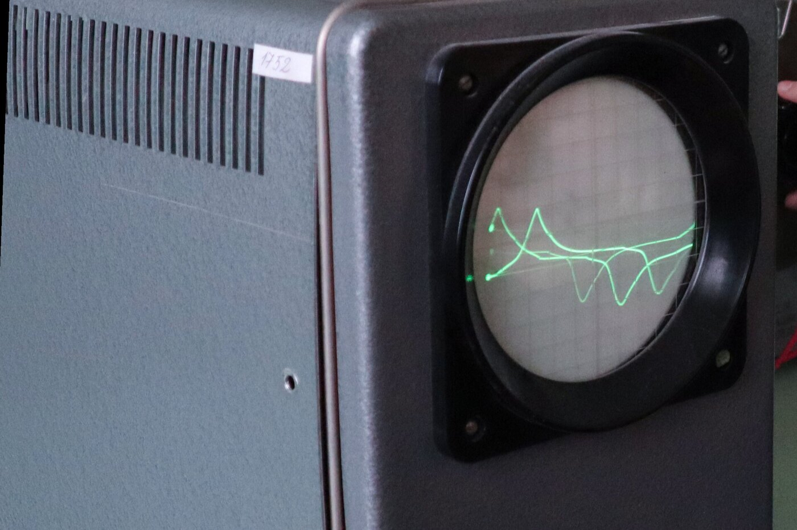

You can find the code at: [github.com/luis-ota/talk](https://github.com/luis-ota/talk).

a build log: giving an agent a mouth without giving it a monologue



one tool, one queue, and a rule about silence.

---

## the problem was never the voice

i run long commands. formatting a card, building an image, downloading a model. i start them and leave the terminal. sometimes i come back twenty minutes later to find the work finished in two. sometimes i assume it finished and it is still writing to the card.

a progress bar is a ui for someone who is still watching. a voice is a ui for someone who isn't.

so the requirement was never "text to speech". it was "tell me when to come back". that difference decides the whole design.

---

## one tool, not a platform

talk is an MCP server with one tool: `speak`. free text, no templates, no ssml, no notification id. the agent writes a sentence in the user's language and the computer says it.

```text
talk_speak("Terminei de formatar o cartão. Pode voltar.")
```

`stop`, `voices`, and `status` exist for maintenance. there is no config endpoint, no voice cloning, no websocket. one process, stdio, and a model on disk. everything runs on the laptop: no api key, no cloud, no per-character bill.

---

## the return has to be instant

the first version synthesized the entire text, played it, and only then returned. the agent sat waiting for its own notification. that is backwards: an alert is only useful if it does not block the thing it is alerting about.

so `speak` enqueues and returns. a daemon thread owns synthesis and playback.

```python
def say(self, text, voice=None, speed=None, interrupt=False):
    ...
    with self._cv:
        self._queue.append({"text": text, "voice": voice, "speed": speed})
        self._cv.notify()
        pending = len(self._queue)
    return {"ok": True, "queued": pending}
```

the agent gets a receipt, not a wait. then it goes back to work.

---

## the first sentence is the latency budget

the second problem was the start delay. synthesizing four hundred characters before playing the first one gives you a second of silence, and silence after a command is exactly what makes you check the screen.

the fix is to split the text into sentences, synthesize them in order, and play each one as soon as it exists.

```python
chunks = split_text(item["text"])

with ThreadPoolExecutor(max_workers=1) as pool:
    futures = [pool.submit(self.synth.synthesize, c, voice, speed) for c in chunks]
    for fut in futures:
        path, _ = fut.result()
        self._play(path)
```

the pool synthesizes the next sentence while the current one is playing. the first sentence is out before the rest of the paragraph exists.

a warmup thread also loads the model as soon as the server starts, so the first real request does not pay the load cost.

| | |
|---|---|
| load model | ~1.9 s, once per process |
| synthesize | ~1.0× real time |
| first sentence out | ~0.7 s |
| repeated sentence | instant |

measured on a ryzen 7 3700u, four cores, no gpu. not instantaneous. fast enough to feel like a reply.

---

## stdout is not yours

in a stdio mcp server, stdout is the json-rpc channel. one careless `print()` and the client sees a log line where a protocol message should be.

so every message in talk goes to stderr.

```python
def log(msg):
    print(f"[talk] {msg}", file=sys.stderr, flush=True)
```

the channel that talks to the agent cannot be used to talk to the human. that is what the speakers are for.

---

## cache the sentence, not the speech

each synthesized chunk is cached under a hash of text, voice, and speed:

```python
key = hashlib.sha256(f"{voice}|{speed}|{text}".encode()).hexdigest()[:20]
```

the same sentence in another voice is a different file. the same sentence in the same voice is free. voice notifications repeat more than you think — "done", "still running", "i need you" — and the cache is pruned to four hundred files so it does not grow forever.

---

## linux audio is a chain of maybes

there is no single audio player. talk tries `paplay`, then `pw-cat`, then `ffplay`, then `aplay`, and lets `TALK_PLAYER` override the guess.

for languages other than english, kokoro also needs `espeak-ng` for phonemes. english works without it. pt-br does not. this is the kind of dependency you discover by hearing the wrong accent, not by reading the docs.

---

## knowing when to shut up

the tool was easy. the behavior is the hard part. an agent with a voice can narrate every step, read logs out loud, and become the worst podcast in the world.

so the server ships instructions with itself: speak when a long task ends, when you are blocked, when the user asks, when you need a decision. one or two sentences. do not narrate. do not read paths or code. `speak` does not block, so continue working after calling it.

the system prompt is part of the product. a voice interface is not only an output; it is a policy about when output is worth making.

---

## what i'd tell past me

i thought the hard part would be making a small model sound human. it wasn't. kokoro-82m is good enough, and on a laptop without a gpu it is fast enough.

the hard part was everything around it:

- returning before the sound, so the agent keeps working
- starting in 0.7 s, so the silence does not make you look
- sharing a channel with json-rpc without corrupting it
- and writing instructions that teach the agent restraint

a demo says "hello". a tool says "done, you can come back" and then stops talking.

## image credits

- cover: [Old vintage radio - Offenburg](https://commons.wikimedia.org/wiki/File:Old_vintage_radio_-_Offenburg.jpg) by th_norge (cc by 4.0)
- image: [Old oscilloscope with round screen without visible knobs or switches](https://commons.wikimedia.org/wiki/File:Old_oscilloscope_with_round_screen_without_visible_knobs_or_switches.jpg) by Demchenko2021 (cc by 4.0)
